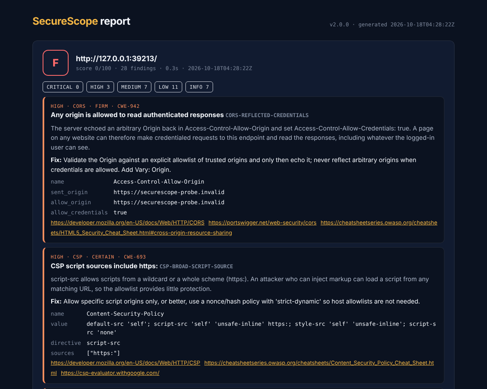

# SecureScope

[](https://github.com/mohamedmoatazsec/SecureScope/actions)


**Web security posture scanner with evidence-backed findings.** Point it at a site you are
authorised to test and it evaluates the transport layer and every security-relevant response
header the way a reviewer would: not "is the header there" but "is it configured so it actually
protects anyone". Every finding carries the exact value it saw, a severity, a confidence level,
a fix written for the people who own the configuration, and CWE / OWASP / MDN references.

It is built to run in two places: on an engagement, as the first ten minutes of every web
assessment; and in CI, where `--fail-on` and `--baseline` turn it into a regression gate that
fails a pipeline only when something got *worse*.

```text
$ securescope app.example.com --fail-on high -f sarif -f html -o reports/

 D   https://app.example.com/   score 52/100 ──────────────────────────────────────────
0 critical  1 high  3 medium  4 low  5 info
Severity    Finding                                            Evidence
HIGH        CSP allows inline scripts ('unsafe-inline')        name=Content-Security-Policy
            CSP-UNSAFE-INLINE · csp                            directive=script-src
MEDIUM      Cookie 'sessionid' is readable by JavaScript       name=sessionid
            (no HttpOnly)                                      header=sessionid=abc…; Path=/; Secure
            COOKIE-NO-HTTPONLY · cookies
MEDIUM      Strict-Transport-Security max-age is only 600      name=Strict-Transport-Security
            seconds                                            value=max-age=600
            HSTS-SHORT-MAX-AGE · headers
MEDIUM      Page can be framed by any site (no                 name=X-Frame-Options
            frame-ancestors or X-Frame-Options)
            CLICKJACKING-UNPROTECTED · headers
LOW         Server header reveals the software version         name=Server  value=nginx/1.18.0
            SERVER-VERSION-DISCLOSED · disclosure
...
Report written: reports/securescope-report.sarif
Report written: reports/securescope-report.html

FAIL 1 finding(s) at or above high
```

<p align="center"></p>

## What it checks

| Check | What is evaluated |
| --- | --- |
| **TLS and transport** | Certificate validity and chain, hostname match, expiry windows, negotiated protocol and cipher, whether TLS 1.0/1.1 are still accepted, whether TLS 1.3 is offered, and whether `http://` redirects to `https://` |
| **Security headers** | HSTS quality (`max-age`, `includeSubDomains`), `X-Content-Type-Options`, clickjacking protection (`frame-ancestors` vs `X-Frame-Options`, invalid `ALLOW-FROM`, wildcards), `Referrer-Policy` values, `Permissions-Policy`, `Cross-Origin-Opener-Policy`, legacy `X-XSS-Protection`, public caching of HTML |
| **Content Security Policy** | A real evaluator: missing or report-only policies, no script restriction, `'unsafe-inline'` without nonces/hashes, `'unsafe-eval'`, wildcard and scheme-only script sources, wildcard hosts, missing `object-src` / `base-uri` / `form-action`, duplicate and unknown directives, no violation reporting. `'strict-dynamic'` is understood |
| **Cookies** | Read from the raw `Set-Cookie` headers: `Secure`, `HttpOnly`, `SameSite` (including `None` without `Secure`), `__Host-` / `__Secure-` prefix rules, domain scope of session cookies. Session-like cookies are rated higher |
| **CORS** | A foreign `Origin` probe and a `null` probe: reflected origins with credentials, `null` with credentials, wildcard with credentials, missing `Vary: Origin` |
| **HTTP methods** | `Allow` header review and a `TRACE` probe that only counts when the request is echoed back. Never sends state-changing methods |
| **Information disclosure** | Version numbers in `Server`, and stack-announcing headers such as `X-Powered-By`, `X-AspNet-Version`, `X-Generator` |
| **Policy files** | `security.txt` (RFC 9116) presence, `Contact`, and `Expires`; `robots.txt` rules as facts |
| **Recon** | Technology fingerprint and DNS by default; WHOIS, common-subdomain resolution and a TCP probe of common ports on request (`--whois`, `--subdomains`, `--ports`). Database and remote-admin services reachable from the internet are flagged |

Every finding has a stable id (`CSP-UNSAFE-INLINE`, `HSTS-SHORT-MAX-AGE`, ...), which is what
baselines, SARIF rules and suppression in your own tooling key on. `securescope --list-checks`
lists the check ids for `--checks` / `--skip-checks`.

### Grades

Each target gets a 0-100 score and a letter grade, computed the simple way so it can be explained
in one sentence: start at 100, subtract 40 per critical, 20 per high, 10 per medium and 4 per low
finding. Informational findings are free. A+ ≥ 95, A ≥ 90, B ≥ 80, C ≥ 65, D ≥ 50, otherwise F.

## Installation

```bash
pip install git+https://github.com/mohamedmoatazsec/SecureScope.git        # the securescope command
pip install "securescope[whois] @ git+https://github.com/mohamedmoatazsec/SecureScope.git"  # with WHOIS
```

Or from a checkout: `pip install .` Requires Python 3.9+. Wheels are attached to every
[GitHub release](https://github.com/mohamedmoatazsec/SecureScope/releases), and a container image
is published on every release:

```bash
docker run --rm -v "$PWD/reports:/reports" ghcr.io/mohamedmoatazsec/securescope example.com -f html
```

## Usage

```bash
securescope example.com                                  # console report
securescope https://app.example.com -f html -f json -o reports/
securescope -t targets.txt -f sarif --fail-on high       # several targets, CI gate
securescope app.example.com --proxy http://127.0.0.1:8080 \
    -H 'Authorization: Bearer eyJ…' --cookie 'session=…'  # authenticated scan through Burp
securescope app.example.com --baseline reports/last-good.json --fail-on medium
securescope app.example.com --stdout json | jq '.targets[0].summary'
```

| Option | Effect |
| --- | --- |
| `-f FMT`, `--format FMT` | Write a report; repeatable. `json`, `html`, `md`, `sarif`, `csv` |
| `-o DIR`, `-n NAME` | Where report files go (default `.`) and their base name (default `securescope-report`) |
| `--stdout FMT` | Print one format to stdout; console output moves to stderr so the result can be piped |
| `--fail-on SEV` | Exit code 2 if any finding is at least `critical`, `high`, `medium` or `low` |
| `--baseline FILE` | Diff against a previous JSON report. With `--fail-on`, only *new* findings fail the run |
| `--checks LIST`, `--skip-checks LIST` | Run or skip specific checks by id |
| `--ports`, `--subdomains`, `--whois` | Enable the slower, noisier recon checks |
| `--proxy URL` | Send all HTTP requests through a proxy (TLS probes connect directly) |
| `-H 'Name: value'`, `--cookie name=value`, `--user-agent UA` | Headers and cookies for authenticated scans |
| `--insecure` | Do not verify certificates for the HTTP requests (the TLS check still reports on them) |
| `--timeout SEC`, `--retries N`, `--concurrency N` | Per-request timeout, retries on 502/503/504, targets scanned in parallel |
| `-q`, `--no-color`, `--show-info` | One line per target; plain output; include informational findings in the console |

Exit codes: `0` clean (or no threshold), `1` usage error or no target reachable, `2` findings at or
above `--fail-on`.

## In CI

The repository doubles as a GitHub Action. It installs the scanner, runs it, writes the Markdown
report to the job summary, and exposes the exit code:

```yaml
- name: Web security posture
  uses: mohamedmoatazsec/SecureScope@v2
  with:
    target: https://staging.example.com
    fail-on: high
    formats: json sarif md
    baseline: .securescope/baseline.json      # optional: only regressions fail the job

- name: Upload to code scanning
  if: always()
  uses: github/codeql-action/upload-sarif@v3
  with:
    sarif_file: securescope-reports/securescope-report.sarif
```

The SARIF file turns every finding into a code-scanning alert with its severity, evidence and
remediation, so the security tab tracks headers and TLS the same way it tracks code. Any other
CI system can run the CLI directly and use the exit code; `--stdout md >> "$GITHUB_STEP_SUMMARY"`
or a PR comment both work with the Markdown output.

To adopt it on an existing site without failing every build on day one: run once, commit the
JSON report as the baseline, and gate on `--baseline` so the pipeline only fails when a new
finding appears. Then burn the baseline down at your own pace.

## Reports

- **JSON** is the canonical format ([schema](docs/report.schema.json)): per-target findings,
  the facts each check collected (certificate details, the parsed CSP, cookies, DNS), scores and
  the baseline diff.
- **HTML** is a single self-contained file: grade, severity filters, evidence tables, references
  and the raw check data, in dark or light mode. Everything that came from the target is escaped;
  a scanned host cannot inject into the report about it (`tests/test_reports.py` pins this).
- **SARIF 2.1.0** for GitHub code scanning and other SARIF consumers.
- **Markdown** for PR comments and job summaries. **CSV** for spreadsheets and ticketing imports.

## Responsible use

SecureScope sends ordinary HTTP requests (GET, OPTIONS, TRACE, a couple of CORS probes), opens a
few TLS connections, and, only when asked, resolves common subdomains and attempts TCP
connections to a short list of ports. It never sends state-changing requests and never tries to
exploit anything. Still: **run it only against systems you own or have explicit, written
permission to test**, respect program scope and rate limits, and treat findings as configuration
observations to verify, not as proof of exploitability.

## Development

```bash
pip install -e ".[dev]"
pytest                       # ~75 tests, all offline: pure analysis functions + a local test server
ruff check . && ruff format .
```

Checks live in `securescope/checks/`; each one is a class with a pure `evaluate_*` function
(tested without a network) and a thin `run()` that fetches what it needs through the shared
session. Adding a check means writing the evaluation, registering the class in
`securescope/checks/__init__.py`, and giving each finding a stable id.

## Contributing

Issues and pull requests are welcome. Please keep new findings evidence-backed, rate them
honestly, and add a test for each one. Report a vulnerability in SecureScope itself privately:
see [SECURITY.md](SECURITY.md).

## License

[MIT](LICENSE) — Mohamed Moataz.
