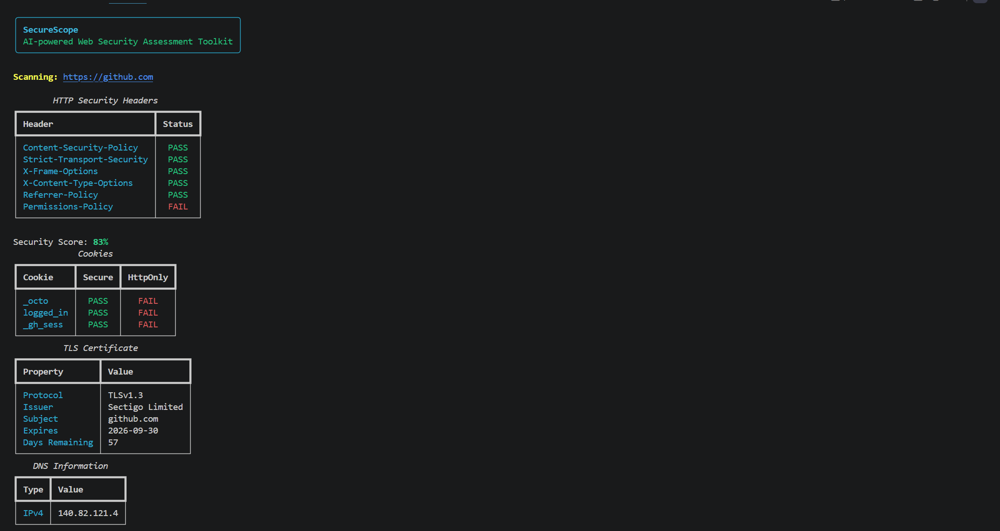
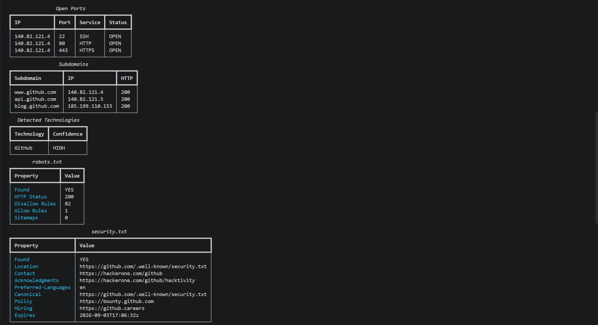
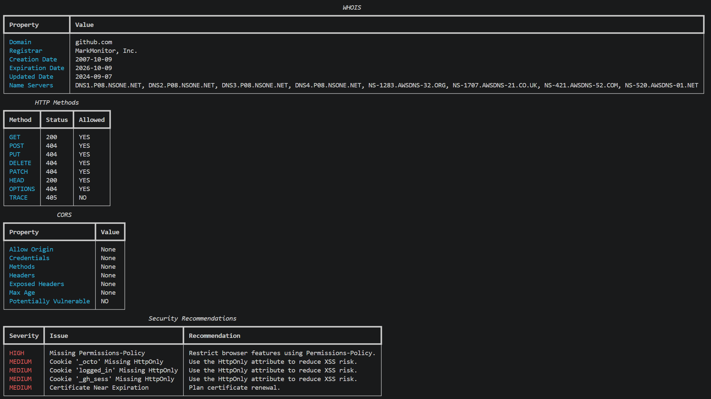

# SecureScope

[](https://github.com/mohamedmoatazsec/SecureScope/actions)


A command-line toolkit that assesses the security posture of a web application and turns the raw
findings into prioritised, actionable recommendations. It covers the reconnaissance and
configuration-review phase of a web penetration test: the checks you run on every target before
you start hunting for application-level bugs.

```text
$ securescope example.com --html

HTTP Security Headers        TLS Certificate                 CORS
Content-Security-Policy FAIL  Protocol  TLSv1.3               Origin reflected       YES
Strict-Transport-Security PASS Issuer   Let's Encrypt         Potentially vulnerable YES - Arbitrary
X-Frame-Options         PASS  Expires  2026-12-01 (44 days)                          origin reflected
...                                                                                  with credentials

Security Recommendations
HIGH    CORS misconfiguration: Arbitrary origin reflected with credentials
HIGH    Missing Content-Security-Policy
MEDIUM  Certificate expiring within 90 days
...
HTML report: ./report.html
```

## What it checks

| Area | Check |
| --- | --- |
| HTTP response headers | Presence of CSP, HSTS, X-Frame-Options, X-Content-Type-Options, Referrer-Policy, Permissions-Policy |
| Cookies | `Secure`, `HttpOnly` and `SameSite` attributes on every cookie the target sets |
| TLS | Negotiated protocol version, issuer, subject and days until the certificate expires |
| CORS | Sends a probe `Origin` and flags reflected origins, `null` origins and wildcard-with-credentials |
| HTTP methods | Which of GET/POST/PUT/DELETE/PATCH/HEAD/OPTIONS/TRACE the server accepts, plus the `Allow` header |
| Recon | DNS (A/AAAA), WHOIS, common subdomains, TCP connect scan of 14 common ports |
| Fingerprinting | Server / X-Powered-By headers and markup signatures (nginx, Apache, IIS, Cloudflare, WordPress, jQuery, ...) |
| Policy files | `robots.txt` rules and `security.txt` (RFC 9116) fields |
| Output | Terminal tables plus HTML, JSON and CSV reports, with findings sorted by severity |

The reports treat every value that came from the target as untrusted and escape it, so an HTML
report cannot be used to attack the person reading it.

## Installation

```bash
git clone https://github.com/mohamedmoatazsec/SecureScope.git
cd SecureScope
pip install .            # installs the `securescope` command
```

Or run it straight from the checkout without installing:

```bash
pip install -r requirements.txt
python cli.py example.com
```

Requires Python 3.9 or newer.

## Usage

```bash
securescope https://example.com                 # terminal output only
securescope example.com --html --json --csv     # also write report.html / report.json / report.csv
securescope example.com --json -o reports/      # put reports in a directory
securescope example.com --skip-ports --skip-subdomains   # faster, HTTP-only checks
securescope --help
```

| Option | Effect |
| --- | --- |
| `--html`, `--json`, `--csv` | Write a report in that format (any combination) |
| `-o DIR`, `--output DIR` | Directory for report files (default: current directory) |
| `--skip-ports` | Skip the TCP port scan |
| `--skip-subdomains` | Skip subdomain discovery |
| `--version` | Print the version and exit |

The JSON report is the one to feed into other tooling:

```json
{
  "tool": "SecureScope",
  "version": "1.1.0",
  "generated": "2026-10-18T01:20:11+00:00",
  "results": {
    "target": "https://example.com",
    "headers": { "Content-Security-Policy": false, "Strict-Transport-Security": true, "...": "..." },
    "cors": { "origin": "https://securescope-probe.invalid", "credentials": "true", "reflected": true, "vulnerable": true },
    "recommendations": [ { "severity": "HIGH", "title": "CORS misconfiguration: ...", "recommendation": "..." } ]
  }
}
```

## Demo

<p align="center">
  
</p>

<details>
<summary>More output</summary>
<p align="center">
  
  
</p>
</details>

## Responsible use

SecureScope sends requests to the target, probes HTTP methods and opens TCP connections to common
ports. Only run it against systems you own or have explicit, written permission to test, such as
a bug bounty program's in-scope assets. You are responsible for staying inside that scope.

## How it is organised

```text
securescope/
├── cli.py              # argument parsing and terminal rendering (rich)
├── scanner.py          # runs every check and assembles the result document
├── headers.py          # security headers + cookie attributes
├── cors.py             # CORS probe and analysis
├── methods.py          # HTTP method enumeration
├── tls.py              # certificate inspection
├── dns.py / whois.py / subdomains.py / portscan.py   # reconnaissance
├── technologies.py     # fingerprinting
├── robots.py / securitytxt.py                        # policy files
├── recommendations.py  # turns results into prioritised advice
└── report_html.py / report_json.py / report_csv.py   # report writers
tests/                  # pytest suite for the parsing and analysis logic (no network needed)
```

Each check is a small module with a pure function for the analysis (`analyze_cors`,
`evaluate_headers`, `parse_robots`, ...) and a thin `scan_*` wrapper that does the network call.
The pure functions are what the tests exercise.

## Development

```bash
pip install -e ".[dev]"
pytest                  # unit tests
ruff check . && ruff format --check .
```

CI runs the same commands on Python 3.9 through 3.13 for every push and pull request.

## Roadmap

- [ ] Header *value* analysis (weak CSP directives, short HSTS max-age)
- [ ] WAF detection
- [ ] Known-vulnerable component detection from fingerprints
- [ ] Configurable wordlists and port lists
- [ ] Concurrency for the recon checks
- [ ] SARIF output for CI integration

## Contributing

Issues and pull requests are welcome. Please keep changes focused, add a test for any new
analysis logic, and make sure `pytest` and `ruff` pass. See [SECURITY.md](SECURITY.md) for how to
report a vulnerability in SecureScope itself.

## License

MIT. See [LICENSE](LICENSE).

---

Built by [Mohamed Moataz](https://www.linkedin.com/in/mohamedmoatazsec) — web & API penetration
tester and bug bounty researcher ([HackerOne](https://hackerone.com/mohamedmoatazsec)).
